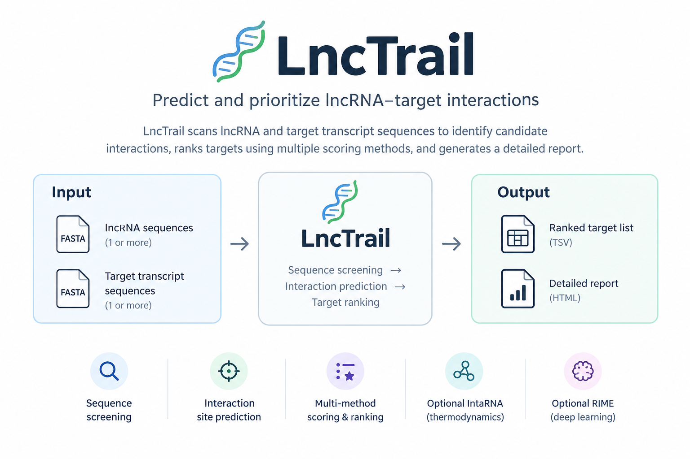

# LncTrail v0.2.3



**LncTrail** — *Long noncoding RNA Target Reconnaissance and Interaction Locator* — is a command-line bioinformatics tool for discovering and prioritizing candidate **lncRNA–RNA interaction sites** from FASTA sequences. It accepts one or many lncRNA query sequences and a FASTA containing target RNA transcripts, then produces a complete query–target scan, detailed candidate sites, ranked target genes, and an HTML report.

> **New in v0.2.3:** result files are created before the expensive prediction phase. Completed target batches are appended and flushed to `lnctrail_results.tsv` as the run progresses. The run log and JSON metadata are updated after each batch. The final ranked results and HTML report are generated after all batches finish.

## Project and author

- **Developer:** [Seyed Ahmad Mousavi (@ahmadsam66)](https://github.com/ahmadsam66)
- **GitHub profile:** <https://github.com/ahmadsam66>
- **Intended repository URL:** <https://github.com/ahmadsam66/LncTrail>

The LncTrail repository URL above is the intended publishing destination. If it does not exist yet, create a public repository named **LncTrail** under `ahmadsam66`, then upload or push the contents of this project folder.

## Table of contents

1. [What LncTrail does](#what-lnctrail-does)
2. [Key features](#key-features)
3. [Scientific scope and limitations](#scientific-scope-and-limitations)
4. [Requirements](#requirements)
5. [Installation](#installation)
6. [Input files](#input-files)
7. [Quick start](#quick-start)
8. [Live progress and incremental output in v0.2.3](#live-progress-and-incremental-output-in-v023)
9. [Output files explained](#output-files-explained)
10. [Command-line options](#command-line-options)
11. [Examples](#examples)
12. [How the workflow works](#how-the-workflow-works)
13. [Using IntaRNA](#using-intarna)
14. [Optional RIME deep-learning rescoring](#optional-rime-deep-learning-rescoring)
15. [Troubleshooting](#troubleshooting)
16. [Tests and reproducibility](#tests-and-reproducibility)
17. [Methods and references](#methods-and-references)
18. [License and citation](#license-and-citation)

## What LncTrail does

LncTrail compares the supplied lncRNA sequence(s) with target-transcript sequence(s) to identify putative RNA–RNA hybridization sites.

**Inputs**

- An lncRNA FASTA file containing one or more query sequences.
- A FASTA file containing target RNA transcript sequences. For lncRNA–mRNA interaction work, mature/spliced transcript sequences in transcript orientation are preferred, including UTRs relevant to the biological question.

**Prediction engines**

- **IntaRNA** — optional external thermodynamic engine. It predicts RNA–RNA interactions while modelling the energetic cost of making sites accessible, and reports available energy, seed and accessibility values.
- **LncTrail built-in engine** — a fast, transparent exact-seed-plus-extension screen. It is useful for a fast first pass and software testing, but does not calculate thermodynamic free energy or RNA secondary-structure accessibility.
- **RIME** — optional, separate deep-learning model used to rescore a limited shortlist. It is not installed or run by default; see [Optional RIME deep-learning rescoring](#optional-rime-deep-learning-rescoring).

All predictions are computational hypotheses. Do not interpret a favorable score as proof of direct binding or biological regulation.

## Key features

- Multithreaded screening (Python worker processes in built-in mode; IntaRNA's own threads in thermodynamic mode).
- Batch execution with live progress messages and incremental results.
- `lnctrail_results.tsv` is created before prediction starts and updated after every completed batch.
- One final audit row per retained lncRNA × target-transcript input pair, even when no site passes the configured filters.
- Separate detailed interaction-site file, avoiding multiple sites per transcript pair overwhelming the complete target inventory.
- Gene-level target ranking, with best-effort gene-symbol inference from FASTA descriptions.
- Configurable seed length, builtin score/pairing cutoffs, target biotype filter, IntaRNA energy filter, thread count, batch size, and shortlist size.
- Optional RIME deep-learning rescoring on a capped candidate shortlist.
- HTML report, JSON run metadata, run log, SHA-256 input checksums, quality warnings, and example inputs.
- No third-party Python dependencies for the built-in engine.

## Scientific scope and limitations

LncTrail focuses on **sequence-based RNA–RNA pairing hypotheses**. FASTA-only analysis cannot establish that two RNAs are expressed in the same cell or condition, colocalize, bind in vivo, regulate one another, or cause a phenotype.

It does not comprehensively predict all lncRNA mechanisms. RNA–protein interactions, RNA–DNA triplex formation, chromatin-mediated regulation, cis effects driven by transcription, and miRNA competition require different inputs and/or specialist methods.

The built-in engine's `binding_score` and LncTrail `priority_score` are heuristic scores, not calibrated probabilities or p-values. IntaRNA energies are thermodynamic predictions in kcal/mol. RIME outputs model scores. These quantities have different meanings and must not be compared as if they share one scale.

Gene symbols parsed from a transcript FASTA description are convenience annotations. Confirm gene/transcript mapping against the matching reference assembly and annotation release. RefSeq accession prefixes are useful for filtering but are not a substitute for a full transcript annotation.

## Requirements

- Python **3.10 or newer**.
- `conda`/`mamba` is recommended when installing IntaRNA.
- The built-in engine uses only the Python standard library.
- IntaRNA is required only for `--engine intarna` or when `--engine auto` selects IntaRNA.
- RIME and its model/checkpoint dependencies are required only when `--rime-repo` is passed.

## Installation

### Option A — use the built-in engine with Python only

Download or clone the project, change into the project directory, and check the command line:

```bash
python3 --version
python3 lnctrail.py --help
```

On Linux/macOS, a virtual environment is recommended but is not required:

```bash
python3 -m venv .venv
source .venv/bin/activate
python -m pip install --upgrade pip
python lnctrail.py --help
```

No `pip install` is required for the built-in engine.

### Option B — install IntaRNA with Conda (recommended for thermodynamic predictions)

Create the environment from the included specification:

```bash
conda env create -f environment.yml
conda activate lnctrail
IntaRNA --version
```

Alternatively, create a minimal environment directly:

```bash
conda create -n lnctrail -c conda-forge -c bioconda python=3.11 intarna -y
conda activate lnctrail
IntaRNA --version
```

If the `IntaRNA` executable is not found, verify the environment is activated and run `command -v IntaRNA`. The executable name is case-sensitive on Linux.

### Optional — install LncTrail as a command

From the project directory:

```bash
python -m pip install -e .
lnctrail --help
```

This registers the `lnctrail` command. The repository can also be run directly with `python lnctrail.py`.

### Running via git clone 

Once the intended repository has been created at `ahmadsam66/LncTrail`:

```bash
git clone https://github.com/ahmadsam66/LncTrail.git
cd LncTrail
python3 lnctrail.py --help
```


## Input files

### 1. lncRNA FASTA (`--lncrna`)

Example:

```fasta
>TCONS_00005049 Transplanted RPE Expressed lncRNA
AUGCUAGCUAGCUAGCUAGCUAGCUAGC
```

### 2. Target-transcript FASTA (`--targets`)

Example:

```fasta
>NM_000001.1 Example transcript one (GENE1), mRNA
GCAUCGUACGUAGCUAGCUAGCUAGCUA
>NM_000002.2 Example transcript two (GENE2), mRNA
AUGCAUGCAUGCAUGCAUGCAUGCAUGC
```

The example sequences are illustrative/synthetic and must not be interpreted as real interaction evidence. Input may be plain FASTA or gzip-compressed FASTA (`.gz`). IDs (the first word after `>`) must be unique within each input file. DNA `T` characters are converted to `U` and noted in warnings; however, for RNA–RNA target discovery, do not use genomic DNA or intron-containing genomic loci in place of mature RNA transcripts.

For each candidate, coordinates are **1-based and inclusive relative to the sequence in the submitted FASTA**. They are not genome coordinates. Target sequences should be in the transcript's biological orientation.

## Quick start

### Built-in screening (no external software dependency)

From the project directory:

```bash
python3 lnctrail.py \
  --lncrna examples/lncrna.fa \
  --targets examples/target_transcripts.fa \
  --outdir results_builtin \
  --engine builtin \
  --threads 4 \
  --batch-size 1
```

The included data are small synthetic smoke-test sequences. `--batch-size 1` is used here to demonstrate frequent progress updates; for a real transcriptome use a larger batch.

### IntaRNA thermodynamic mode

```bash
python3 lnctrail.py \
  --lncrna input.fa \
  --targets GCF_000001405.13_GRCh37_rna.fna \
  --outdir results_intarna \
  --engine intarna \
  --target-biotype all \
  --threads 12 \
  --batch-size 250 \
  --top-targets 200 \
  --top-sites 1000
```

The `--min-energy -10` option can be added to retain only IntaRNA predictions whose reported interaction energy is at most −10 kcal/mol. This is an example cutoff, not a universal biological threshold. Decide filtering thresholds based on the scientific question, known interactions and appropriate decoy/benchmark data.

## Live progress and incremental output in v0.2.3

This release changes **when files are written**, not the underlying scientific interpretation of the prediction engines.

1. LncTrail validates and parses the FASTA inputs and checks the selected engine.
2. Before the prediction workload begins, it creates `lnctrail_results.tsv` and `lnctrail_candidate_sites.tsv` with their column headers. It also creates `run.log` and `run_metadata.json` with `status: running`.
3. Targets are divided into batches. The default is **250 target transcript records per batch**. Each batch is processed against all query lncRNAs.
4. When a batch completes, its pair-level rows are appended to `lnctrail_results.tsv`; its actual predicted sites are appended to `lnctrail_candidate_sites.tsv`. The files are flushed to disk, and a progress line is printed. The log and metadata are updated with completed targets/pairs, candidate counts and elapsed time.
5. When the scan finishes, metadata changes to `status: finalizing`, and LncTrail announces that it is calculating global scores/ranks. It then rewrites the same TSV file paths with the finalized complete results and writes the ranked-target tables, HTML report, final metadata and completion record.

**Important while a job is running:** the main TSV contains only completed batches, not the unprocessed targets. `run_metadata.json` reports the run status and progress. The candidate rows in the live TSV are provisional: final target ranks and integrated/RIME scores are calculated after all primary batches are complete. The final TSV has one row for every input lncRNA × target pair and is written in original input order.

The batching approach intentionally uses separate bounded IntaRNA runs rather than assuming IntaRNA flushes each result row to a pipe immediately. It makes incremental progress more reliable across installations. Smaller batches display updates more often but increase program-startup overhead; larger batches reduce overhead but take longer between updates.

You can monitor a live run from a second terminal:

```bash
# Follow the human-readable progress log
tail -f results_intarna/run.log

# Watch how many rows have reached the live TSV (header is the first line)
watch -n 3 'wc -l results_intarna/lnctrail_results.tsv'

# Inspect machine-readable progress/status
python - <<'PYCODE'
import json
with open('results_intarna/run_metadata.json') as f:
    m = json.load(f)
print('status:', m.get('status'))
print('processed targets:', m.get('processed_targets'), '/', m.get('target_count'))
print('processed pairs:', m.get('processed_pairs'), '/', m.get('pair_count'))
PYCODE
```

Examples:

```bash
# More responsive progress: finish a batch after every 50 target records
--batch-size 50

# Fewer IntaRNA launches, but less frequent updates
--batch-size 1000
```

`--batch-size` counts **target records**, not total query–target pairs. If 10 lncRNAs and a batch of 50 targets are supplied, up to 500 input pairs are written after each batch.

If the process is forcibly terminated, the TSVs and metadata are useful partial records, but **automatic resume is not implemented in v0.2.3**. A new run in the same output directory starts new files. Inspect `run_metadata.json` and `run.log` to determine whether the previous run completed.

## Output files explained

| Output file | When available | Description |
|---|---|---|
| `lnctrail_results.tsv` | Created before prediction; appended per batch; finalized at end | Complete input-pair inventory: one row per lncRNA × target transcript. A row can have `candidate_found` or `no_candidate_passed_filters`. |
| `lnctrail_candidate_sites.tsv` | Created before prediction; appended per batch; finalized at end | Actual candidate interaction sites with coordinates, sequence fragments, engine evidence, scores/energies and structural fields where provided. Usually much smaller than the full scan. |
| `lnctrail_ranked_targets.tsv` | After completion | All detected target-gene candidates sorted by the final priority index. Transcript isoforms are collapsed using inferred gene symbols where possible. |
| `lnctrail_top_targets.tsv` | After completion | Top target-gene shortlist (200 entries by default, configurable). |
| `lnctrail_top_sites.tsv` | After completion | Top interaction sites (1,000 by default, configurable). |
| `lnctrail_report.html` | After completion | Browser-viewable report with summary statistics, warnings, candidate table and links to TSV outputs. |
| `run_metadata.json` | Created before prediction; updated per batch; finalized at end | Run status, input checksums, parameters, processed target/pair counts, engine, warnings, runtime and summary counts. |
| `run.log` | Created before prediction; updated per batch | Human-readable run header, progress lines and final status. |
| `intermediate/` | During execution | Normalized per-batch FASTA and raw IntaRNA logs when retained; controlled by `--keep-intermediate`. |
| `rime_shortlist/` | Only if RIME is requested | RIME input, output and log files for the selected shortlist. |

A `no_candidate_passed_filters` row is **not** an experimentally tested negative and does not prove that the lncRNA has no interaction with that target. The result means only that no interaction was retained under the configured method and parameters.

## Command-line options

Run `python3 lnctrail.py --help` for the complete current list. The principal options are:

| Option | Default | Purpose |
|---|---:|---|
| `--lncrna` | Required | lncRNA query FASTA (`.gz` supported). |
| `--targets` | Required | Target transcript FASTA (`.gz` supported). |
| `--outdir` | `lnctrail_results` | Output directory. Existing results files of the same names are overwritten at run start/finalization. |
| `--engine` | `auto` | `auto` selects IntaRNA if found, otherwise built-in. Use `intarna` or `builtin` to make the engine explicit. |
| `--threads` | Up to 8 | CPU workers; IntaRNA receives native `--threads`. |
| `--batch-size` | `250` | Target records per batch. Smaller = more frequent output updates, more startup overhead. |
| `--seed-length` | Engine-dependent | Default is 12 nt for built-in and 7 nt for IntaRNA. Set explicitly for controlled comparisons. |
| `--max-sites-per-pair` | `1` | Maximum candidate sites emitted per lncRNA–target pair. |
| `--min-energy` | Unset | IntaRNA-only filter, retain predicted energies `<=` the given kcal/mol value (e.g. `-10`). |
| `--min-score` | `26` | Built-in heuristic score cutoff. This is not energy or probability. |
| `--min-pairs` | `12` | Built-in minimum alignment length, including mismatches. |
| `--extension` | `18` | Built-in maximum extension length on each side of an exact seed. |
| `--max-seed-occurrences` | `200` | Built-in cap on indexed occurrences per query seed to reduce low-complexity explosion. |
| `--target-biotype` | `all` | Keep all targets, or apply approximate RefSeq `NM_`/`XM_` protein-coding filtering. |
| `--top-targets` | `200` | Number of target-gene entries in the shortlist. |
| `--top-sites` | `1000` | Number of site entries in the shortlist. |
| `--html-rows` | `1000` | Maximum number of candidate rows embedded in HTML (the TSV remains complete). |
| `--allow-overlapping-sites` | Off | Allows overlapping IntaRNA predictions. |
| `--temperature` | `37.0` | IntaRNA temperature in Celsius. |
| `--rime-repo` | Off | Local RIME repo path; enables optional RIME shortlist rescoring. |
| `--rime-top-targets` | `30` | Number of distinct target-gene transcript representatives passed to RIME. |
| `--rime-bedtools-path` | Unset | Path to the BEDTools executable required by the current RIME wrapper. |
| `--max-pairs` | `250000` | Safety limit for query × target pairs. |
| `--force-large-search` | Off | Allows searches above `--max-pairs`. Use only when you understand the expected workload. |
| `--keep-intermediate` | Off | Keeps per-batch normalized FASTA and successful raw IntaRNA output logs. |

## Examples

### One lncRNA and a transcriptome

```bash
python3 lnctrail.py \
  --lncrna input.fa \
  --targets transcriptome.fa \
  --outdir results \
  --engine intarna \
  --threads 12 \
  --batch-size 250
```

### Multiple query lncRNAs

```bash
python3 lnctrail.py \
  --lncrna multiple_lncrnas.fa \
  --targets target_transcripts.fa \
  --outdir multiple_query_results \
  --engine intarna \
  --threads 8 \
  --batch-size 100
```

The full scan contains one row for every retained query × target pair. For example, 10 lncRNAs × 34,472 target transcripts produces 344,720 rows in the final `lnctrail_results.tsv` (assuming the target filter keeps all records).

### Faster exploratory screening without IntaRNA

```bash
python3 lnctrail.py \
  --lncrna input.fa \
  --targets transcriptome.fa \
  --outdir results_fast \
  --engine builtin \
  --threads 12 \
  --batch-size 500 \
  --seed-length 12 \
  --min-pairs 12 \
  --min-score 26
```

### Use only the RefSeq mRNA-like accessions

```bash
python3 lnctrail.py \
  --lncrna input.fa \
  --targets GCF_000001405.13_GRCh37_rna.fna \
  --outdir results_mrna \
  --engine intarna \
  --target-biotype protein-coding \
  --threads 12 \
  --batch-size 250
```

The built-in filter is a simple accession/description heuristic, not a definitive annotation pipeline. Use `--target-biotype all` when the goal is to preserve every transcript record in the input FASTA.

## How the workflow works

1. **Input validation:** parse FASTA records, validate sequence characters, check unique sequence IDs and convert `T` to `U`.
2. **Batch setup:** split target transcripts into fixed-size groups while retaining all lncRNA queries for each batch.
3. **Prediction:** use IntaRNA's thermodynamic interaction model or the built-in exact-seed heuristic.
4. **Incremental audit outputs:** after each target batch, append a complete row for every query × target pair in that batch and append any candidate site rows.
5. **Global assessment:** after all batches, calculate sequence complexity and seed-specificity features, a heuristic priority index, target ranks, and gene-level summaries.
6. **Optional RIME:** when explicitly configured, evaluate a small shortlisted set and integrate its model score as a separate evidence component.
7. **Finalization:** overwrite the progressive TSVs with finalized tables and produce the ranked shortlists, HTML report, metadata and log.

The primary candidate-site list and target-pair inventory are distinct by design. The target-pair inventory records all pairs; the candidate-site file contains only detected sites.

## Using IntaRNA

IntaRNA is an established RNA–RNA interaction predictor that models hybridization energetics, seed interactions and site accessibility. LncTrail calls the external `IntaRNA` executable and requests energy, hybridization-energy, seed and accessibility-related columns where supported by the installed version.

Check the installed executable:

```bash
command -v IntaRNA
IntaRNA --version
```

If `--engine intarna` is specified and the executable cannot be found, LncTrail stops with an error. The tool does not silently replace explicitly requested IntaRNA calculations with the built-in heuristic.

IntaRNA may produce a different number and pattern of sites compared with the built-in engine. That is expected because the engines use different models and filters. For a fair comparison, record versions and parameters and benchmark on known interactions plus appropriate decoys where possible.

## Optional RIME deep-learning rescoring

RIME is a published deep-learning approach for RNA–RNA interaction prediction. LncTrail's RIME option is disabled by default and does not download or install RIME automatically. It requires the external RIME repository, its own model/checkpoints and model environments, and a valid BEDTools executable path for the wrapper used by this release.

After installing and testing the official [RIME repository](https://github.com/tartaglialabIIT/RIME), the invocation pattern is:

```bash
python3 lnctrail.py \
  --lncrna input.fa \
  --targets target_transcripts.fa \
  --outdir results_rime \
  --engine intarna \
  --threads 8 \
  --batch-size 250 \
  --rime-repo /path/to/RIME \
  --rime-top-targets 30 \
  --rime-bedtools-path /path/to/bedtools
```

Check the current official repository for exact environment setup, model files, expected input/output formats and licensing. RIME's score is not a thermodynamic energy or a calibrated interaction probability. LncTrail sends only a limited set of top target transcript representatives to RIME rather than all target records. RIME is applied after the primary scan, so it does not affect progress during IntaRNA batches.

## Troubleshooting

### The output file exists but is nearly empty

Inspect `run_metadata.json`:

```bash
python - <<'PY'
import json
with open('results/run_metadata.json') as f:
    d = json.load(f)
for k in ('status', 'processed_targets', 'target_count', 'processed_pairs', 'pair_count', 'runtime_seconds', 'error'):
    print(f'{k}: {d.get(k)}')
PY
```

If status is `running`, only completed batches have been appended. If status is `finalizing`, the primary scan has completed and LncTrail is calculating global scores/ranks and writing the remaining reports. If a hard termination occurred, the metadata may remain `running` or `finalizing`; there is no automatic resume in this version.

### Progress updates are too infrequent

Use a smaller batch size, such as `--batch-size 50`. Each batch restarts IntaRNA, so smaller batches increase startup overhead.

### The IntaRNA run is slow

Use a larger `--batch-size` (e.g. 500 or 1000) to reduce startup overhead, accepting fewer progress updates. Keep `--threads` in line with available CPU cores and memory. Consider screening the target universe first if scientifically acceptable, while recognizing that prefiltering may miss interactions.

### `IntaRNA` is not found

Activate the Conda environment and check `command -v IntaRNA`. Use `--engine builtin` only when you intentionally want the heuristic mode. Verify the engine line printed at startup.

### There are no candidate sites

Try checking the input orientation, transcript type, IDs, target sequence lengths, seed parameters, and filtering thresholds. For the built-in engine, you may test less restrictive `--seed-length`, `--min-pairs`, or `--min-score` settings. Do not relax filters solely to manufacture a desired number of candidates.

### HTML report is absent

The report is generated only after all primary batches finish and final tables are built. While running, use `lnctrail_results.tsv`, `lnctrail_candidate_sites.tsv`, `run.log` and `run_metadata.json` to monitor progress.

## Tests and reproducibility

Run the unit tests:

```bash
python -m unittest discover -s tests -v
```

Run the built-in smoke-test example:

```bash
bash run_example.sh
```

For CI, a GitHub Actions workflow runs the tests on supported Python versions. A run records SHA-256 checksums for the original input files, selected engine, parameters, counts, warnings and timing. Record the IntaRNA version and any external RIME model version when reporting results.

Reproducibility notes:

- The final complete target scan is ordered by input lncRNA and target FASTA order.
- Candidate ranks may change after global scoring because seed specificity is evaluated against the entire target set.
- Gene-level aggregation is approximate until checked against assembly-matched annotations.
- A changed input file, software version or parameter setting can change results.
- Live TSV rows are preliminary batch records; use the finalized files after `status` becomes `completed`.

## Methods and references

- **IntaRNA** — Mann et al. *Nucleic Acids Research* (2017), DOI: [10.1093/nar/gkx279](https://doi.org/10.1093/nar/gkx279); [official documentation](https://backofenlab.github.io/IntaRNA/); [GitHub](https://github.com/BackofenLab/IntaRNA).
- **RIME** — Setti et al. *Nature Communications* (2026), DOI: [10.1038/s41467-026-68356-w](https://doi.org/10.1038/s41467-026-68356-w); [repository](https://github.com/tartaglialabIIT/RIME); [web server](https://tools.tartaglialab.com/rna_rna).
- **RNAplex** — ViennaRNA documentation: <https://viennarna.readthedocs.io/en/latest/man/RNAplex.html>.
- **RNAup** — ViennaRNA documentation: <https://viennarna.readthedocs.io/en/latest/man/RNAup.html>.
- **RIsearch2** — Alkan et al. *Nucleic Acids Research* (2017), DOI: [10.1093/nar/gkw1325](https://doi.org/10.1093/nar/gkw1325); [software/manual](https://rth.dk/resources/risearch/).
- **RIblast** — [source repository](https://github.com/fukunagatsu/RIblast).
- **LncTar** — Li et al. *Briefings in Bioinformatics*, DOI: [10.1093/bib/bbu048](https://doi.org/10.1093/bib/bbu048).
- Mammalian lncRNA interaction-tool benchmarking — *Briefings in Bioinformatics* (2019), DOI: [10.1093/bib/bby032](https://doi.org/10.1093/bib/bby032).
- Experimental interaction resource — LncTarD 2.0: <https://lnctard.bio-database.com/>.
- DNA-triplex alternatives — [LongTarget](https://github.com/LongTarget/LongTarget) and [Triplexator](https://github.com/Triplexator/Triplexator).

See [`TOOLS_REVIEW.md`](TOOLS_REVIEW.md) for a wider comparison of predictors and mechanism-specific methods.

## License and citation

LncTrail is distributed under the MIT License; see [`LICENSE`](LICENSE).

If you use LncTrail in a research project, cite the version/commit you ran and the underlying prediction engine(s). The repository does not currently have a peer-reviewed LncTrail publication. Please do not cite LncTrail as a validated clinical diagnostic or interaction-assay replacement.
